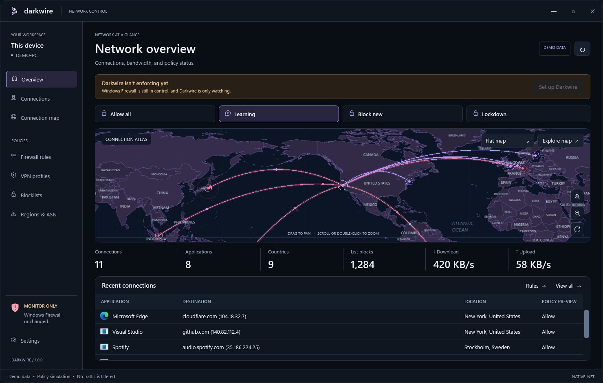
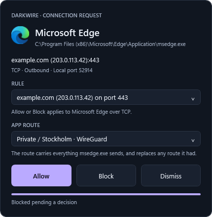
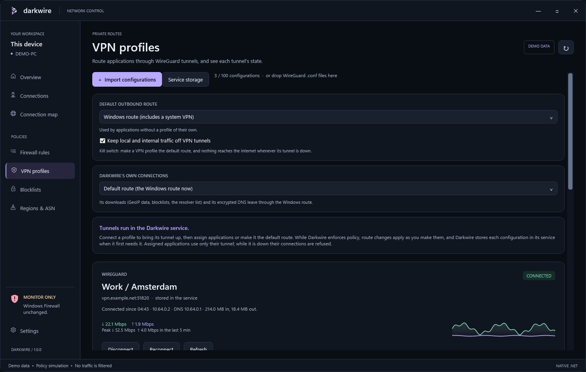
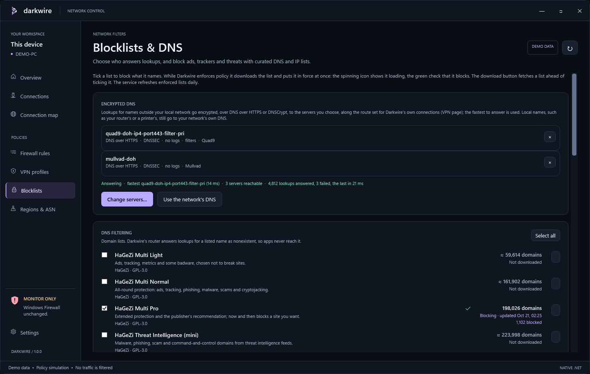

# Darkwire

Darkwire is a firewall for Windows 11. It takes over from Windows Firewall without losing what Windows allowed, can ask before anything new connects, sends chosen applications through WireGuard tunnels, encrypts DNS to servers you pick, blocks ads, trackers, threats, countries and network operators, and draws every connection on a live map. It is a native C# / .NET 10 WPF desktop app and a protected Windows service: no Electron, WebView, browser UI or web server.

**1.0.0** · [MIT License](LICENSE)



*Screenshots show Darkwire's built-in demo data.*

## Features

- **Takes over from Windows Firewall.** Windows' rules are read from the local rule store and translated exactly where possible; a rule Darkwire can't express is reduced or kept disabled, never widened, and only a block broader than Windows' own asks for your consent. **Restore Windows Firewall** hands control back at any time.
- **Four modes**: **Allow all**, **Learning**, **Block new** and **Lockdown**.
- **Learning notifications.** A new connection that no rule covers is held while a small notification beside the tray asks **Allow**, **Block** or **Dismiss**: for that host and port, any host on the port, or anything, and through which route. Allowed in time, the held connection simply continues.
- **A full rule editor** with Windows Firewall's primary rule fields (application, service, user, package, addresses, ports, protocol, ICMP types, network profile, edge traversal), inline editing, search, sortable and reorderable columns, and JSON export.
- **A connection router** on Darkwire's own Wintun adapter, with no custom driver, that decides each new connection before it leaves. A refused connection reaches its application as a refusal.
- **Per-application WireGuard VPN routing.** Up to 100 profiles. Send chosen applications, every other application (with a kill switch), or Darkwire's own connections through a tunnel. Each profile has **Connect**, **Disconnect**, **Reconnect** and **Refresh**, a live throughput chart, and a tunnel that is reconnected by itself when its server stops answering.
- **Encrypted DNS** over DNS over HTTPS or DNSCrypt, through the bundled dnscrypt-proxy, to servers you pick from the DNSCrypt project's signed public resolver list or add yourself. The fastest one answers.
- **Blocklists**: 13 curated lists (HaGeZi, URLhaus, AdAway, FireHOL, Anudeep, 1Hosts, OISD, KADhosts), custom lists from any HTTPS address, and names blocked one by one, each with a count of what it blocked.
- **Country and ASN policy** from bundled DB-IP Lite data, refreshed weekly: block countries or allow only some, block a network operator's autonomous system, and look up who runs any address.
- **A startup lock** that keeps the internet blocked from boot until Darkwire has its policy, router and tunnels up.
- **A connection atlas**: a flat map and a 3D globe of live connections down to the city, with the attempts Darkwire refused in red. Map and city data are bundled and work offline.
- **A connections table and inspector** giving each connection's application (and service, for shared service hosts), destination, place, route and autonomous system, with CSV export.
- **Tamper protection.** Policy and VPN credentials live in the service's protected state, every change needs an administrator, and the service checks its own files and filters every 30 seconds.
- **Dark, light and Windows-following themes**, left or top navigation, and map effects with a reduced-motion switch.
- **Private by design**: no accounts, no telemetry, no analytics and no crash reports ([privacy](#privacy)).

## Building from source

Darkwire builds on Windows 11 x64 with:

- the [.NET 10 SDK](https://dotnet.microsoft.com/en-us/download/dotnet/10.0) (x64);
- for the installer, Visual Studio with the **Microsoft Visual Studio Installer Projects** extension, since only Visual Studio builds Setup projects.

The solution has no third-party NuGet packages. The scripts run in Windows PowerShell 5.1; where scripts are blocked, run each as `powershell -ExecutionPolicy Bypass -File .\scripts\<script>.ps1`.

```powershell
.\scripts\test.ps1                # build, then run the checks
.\scripts\build.ps1 -Package      # build the app, the service and the installer
dotnet native\Darkwire.Host\bin\Release\net10.0-windows\Darkwire.dll --demo   # the app on labelled demo data
```

`build.ps1 -Package` writes the installer to `artifacts\Darkwire-1.0.0-x64.msi`. `test.ps1 -NativeReadOnly` adds read-only checks against this PC's firewall rules, sockets and routes, and `test.ps1 -Screenshots` renders every page on the demo data into `artifacts\screenshots`. The demo doesn't open while an installed Darkwire is running.

A package built that way has no connection router, VPN or encrypted DNS. Those runtimes come from their official releases, and the build accepts only the exact files it pins by SHA-256 (and, for WireGuard's and Wintun's, by WireGuard LLC's signature):

| Download | From | Adds |
| --- | --- | --- |
| `wintun-0.14.1.zip` | [wintun.net/builds](https://www.wintun.net/builds/) | The connection router's adapter |
| `wireguard-amd64-1.1.1.msi` | [download.wireguard.com/windows-client](https://download.wireguard.com/windows-client/) | VPN tunnels |
| `dnscrypt-proxy-win64-2.1.18.zip` | [dnscrypt-proxy 2.1.18](https://github.com/DNSCrypt/dnscrypt-proxy/releases/tag/2.1.18) | Encrypted DNS |
| `dbip-country-lite-YYYY-MM.csv.gz`, `dbip-asn-lite-YYYY-MM.csv.gz`, `dbip-city-lite-YYYY-MM.csv.gz` (optional) | DB-IP's [country](https://db-ip.com/db/download/ip-to-country-lite), [ASN](https://db-ip.com/db/download/ip-to-asn-lite) and [city](https://db-ip.com/db/download/ip-to-city-lite) Lite downloads | GeoIP data in the installer |

```powershell
.\scripts\build-backends.ps1 -WireGuardMsi .\wireguard-amd64-1.1.1.msi -DnsCrypt .\dnscrypt-proxy-win64-2.1.18.zip -Output .\backends
.\scripts\build.ps1 -Package -Wintun .\wintun-0.14.1.zip -Backends .\backends -GeoIp .\geoip
```

`build-backends.ps1` takes `wireguard.exe` out of WireGuard's installer and `dnscrypt-proxy.exe` out of its archive without running either. `-GeoIp` names a folder holding one month's three DB-IP files; without it, the service downloads DB-IP's current release when it first starts. Without Wintun, takeover is refused while connection routing is on; with routing off, Darkwire enforces through kernel filters alone, so VPN routing, DNS filtering, blocked names, encrypted DNS and country allow lists are unavailable, and Learning blocks new connections instead of holding them. Each runtime's license text installs beside it.

## Installation and first setup

You need Windows 11 x64, an administrator account and the [.NET 10 Desktop Runtime](https://dotnet.microsoft.com/en-us/download/dotnet/10.0) (x64). Setup stops with a message if the runtime is missing.

1. **Get the installer**, `Darkwire-1.0.0-x64.msi`, from the 1.0.0 release (or build your own), and compare its SHA-256 with the release's `SHA256SUMS.txt`:

   ```powershell
   Get-FileHash .\Darkwire-1.0.0-x64.msi
   ```

2. **Run it.** Darkwire is not code-signed, so SmartScreen says it protected your PC: choose **More info**, then **Run anyway**. The administrator prompt names an unknown publisher, and with Smart App Control on, Windows may refuse to run Darkwire at all. Setup installs to `C:\Program Files\Darkwire`, starts the Darkwire service and leaves Windows Firewall in control.
3. **Open Darkwire** from the Start menu. It always runs as administrator, so Windows asks for approval when you start it; at sign-in it starts in the tray without asking. Setup, VPN changes and Learning answers then need no further approval.
4. **Say where you are.** The first run asks for your country and city and, if you like, a pin on the map for your exact spot. It only places this PC on Darkwire's maps and never leaves the PC. **Not now** uses Windows' region setting instead.
5. **Pick a mode** at the top of the Overview. **Learning**, the default, is the best start: what Windows allowed keeps working, and anything new asks you. The first takeover can't be in **Allow all**.
6. **Set up.** The Overview says *Darkwire isn't enforcing yet*. Click **Set up Darkwire**, then **Set up and take over**. Setup checks the service, loads the policy, validates it against a fresh read of your Windows Firewall rules, and takes over at once when nothing needs you. If a Windows block would become broader under Darkwire, or the draft has enabled rules of your own, the **takeover review** opens instead: look it over, tick **Enforce these blocks as listed** if it asks, and click **Take over**.
7. **Check the status card**: **FILTERING ACTIVE**, with a green shield. Applications that were connected at the takeover keep working, each with a rule in the **Takeover** group that allows it out.

Then set up what you want: [VPN](#vpn), [encrypted DNS](#dns), [blocklists](#blocklists-custom-blocks-and-their-null-route), [countries](#geo-blocks) and [autonomous systems](#asn-blocks-and-lookup).

**Restore Windows Firewall** (Settings → Filtering service) hands control back to Windows. The service keeps the policy it enforced, and the next setup brings it back. A newer package installs over the old one, keeping the policy and an active takeover; the app then restarts itself into the new build from the tray, or offers **Restart** while its window is open. To remove Darkwire, uninstall it from Windows Settings → Apps → Installed apps: removal restores Windows Firewall first, and removes nothing if that fails. It also deletes the service's policy and stored VPN profiles; your app settings in `%LOCALAPPDATA%\Darkwire` stay. If setup fails, it rolls back and `C:\Program Files\Darkwire\setup.log` says why.

## Configuring Darkwire

### Firewall

Darkwire decides each connection in this order:

1. A matching **deny** rule blocks it.
2. Country and ASN restrictions, then blocklists, block it.
3. A matching **allow** rule allows it.
4. Traffic with internal networks follows the **Internal networks** setting.
5. Anything else follows the mode.

| Mode | Connections no rule decides |
| --- | --- |
| **Allow all** | Allowed. Rules, lists and restrictions are bypassed; VPN routes still apply. |
| **Learning** | Held while a notification asks you, or blocked until you answer when the router can't hold them. |
| **Block new** | Blocked. |
| **Lockdown** | Everything is blocked except loopback, DHCP and IPv6 discovery. No tunnel or DNS proxy runs. |

Choose the mode at the top of the Overview, or from the tray icon's **Preview** items. Loopback is never filtered.

**Learning notifications** show the application (with its service, for `svchost.exe`), the destination, protocol and direction, and a bar that empties over the 60 seconds you have to answer, turning amber for the last ten.

- **RULE** sets how far the answer reaches: that host on that port (over the protocol asked about), any host on that port (TCP and UDP), or that host or any host on any port (every protocol); always for that application and direction.
- **APP ROUTE** sends the application through a VPN profile from now on.
- **Allow** and **Block** add the rule and close the notification at once. The answer also settles the application's other waiting requests it covers. **Dismiss** closes it without an answer, so the connection stays blocked.

A held connection continues if you allow it before its application gives up. One the router can't hold, such as an inbound connection, stays blocked, and its application must try again.



**Firewall rules page.** Double-click a cell to edit it; drag a header to move its column, click it to sort.

- **+ New rule** asks for the name, path (or **Browse**), action, direction, VPN route, protocol, remote addresses and remote ports; the table edits the rest.
- **Import Windows rules** reads Windows Firewall's rules again (setup does this too). The **Windows import** column says how each one translated: blank when exact, **Reduced scope**, **Broader block · review** (enforced only after your consent), **Not enforced · out of scope**, or **Kept disabled**. Darkwire never allows traffic that Windows blocked.
- **Columns** shows or hides columns, among them Local addresses, ICMP types/codes, Package and Edge traversal. **Export** saves the rules as JSON. **Delete** removes the selected rule.
- On the Connections page, double-click a connection (or click **Details & rule actions**) for **Create allow rule** or **Create deny rule**.

| Field | Accepts |
| --- | --- |
| Path | The executable's full path, `System` for the kernel, or `*` for every application |
| Ports | `*`, ports and ranges: `80,443,8000-8080` |
| Addresses | `*`, IPv4 and IPv6 addresses, CIDRs, ranges such as `192.0.2.1-192.0.2.20`, and (remote only) `LocalSubnet`, `DNS`, `DHCP`, `WINS` and `DefaultGateway`, with `4` or `6` after the keyword for one address family |
| Protocol | `Any`, `TCP`, `UDP`, `ICMPv4`, `ICMPv6`, or `IP 0` to `IP 255` |
| ICMP types/codes | `type:code` pairs such as `8:*` or `128:0` |
| Location | The Windows network profile: `Any`, or `Domain`, `Private` and `Public`. It is not a country. |
| Service, User, Package | One service name or `AllServices`; account names or SIDs; an AppContainer SID or `AllPackages` |

**Internal networks**, on the rules toolbar: **Allow all internal** (the default) lets this PC reach private, link-local and unique local addresses, multicast and broadcast, and lets them reach it on networks Windows calls private or domain, so a public hotspot's neighbors stay out. The alternatives are **Block internal unless a rule allows it** and **Decide internal by rules and prompts**.

**Applying changes.** While Darkwire enforces, changes to VPN routes, internal networks, blocklists, blocked names, encrypted DNS, countries, autonomous systems, the startup lock and Windows Security's warnings apply by themselves a moment after you make them. Rules, the mode, and the two switches under Settings → Filtering service stay a draft, as the footer says, until you apply them there:

1. **Load active policy**, so the draft starts from what the service enforces. Do this again after restarting the app or answering a Learning notification: **Apply draft** refuses a draft older than the service's policy.
2. Edit the rules or the mode.
3. **Validate draft** if you like, then **Apply draft**.

### VPN



Darkwire runs WireGuard tunnels inside its service. On the **VPN** page:

1. **Import.** Click **+ Import configurations** and pick your provider's WireGuard `.conf` files, or drop them anywhere on the window. Up to 100. Each is encrypted for your Windows account and stored in the service the first time a route needs it (**Store in service** does that at once). Importing alone connects nothing.
2. **Route** traffic through a profile, in any of these ways:
   - **+ Assign application** on its card: pick a program seen connecting or named in your rules, or **Browse…** for one. The program then uses only that tunnel; while the tunnel is down its connections are refused, never sent another way. Each program has one route. `svchost.exe` can't take one, since every Windows service in it would go along. The rules page's **VPN route** column, the New rule dialog and a Learning notification's **APP ROUTE** set the same thing.
   - **DEFAULT OUTBOUND ROUTE**: **Windows route (includes a system VPN)**, or a profile that carries every application without one of its own. A profile here is a **kill switch**: while its tunnel is down or still connecting, those applications reach nothing beyond your local networks, not even DNS, and Darkwire never falls back to the Windows route. Kernel filters keep it so while the service is stopped, too.
   - **DARKWIRE'S OWN CONNECTIONS**: the default route, the Windows route, or one profile, for Darkwire's downloads and its encrypted DNS. Through a profile they wait while its tunnel is down rather than leave another way.
   - **Connect** brings a tunnel up with nothing routed through it yet.
3. **Watch the card.** Its badge reads **CONNECTING**; **CONNECTED** (since when, its addresses and DNS, bytes in and out, current and peak throughput and a five-minute chart); **NO REPLY** when its server answers nothing sent through it; **DOWN** with the error; **DISCONNECTED**; or why it isn't running. After 45 seconds without a reply, Darkwire reconnects the tunnel from a new local port, less often each time until the server answers.
   - **Disconnect** stops the tunnel and refuses what it carries until you connect it again. Disconnecting the default route asks first.
   - **Reconnect** starts the tunnel again with a new connection to its server.
   - **Refresh** asks the tunnel's DNS server a question through it and shows how fast it answered.

**Keep local and internal traffic off VPN tunnels** (on by default) keeps printers, shares and your router's page reachable directly, under your rules, unless a tunnel routes that private network itself, as an office VPN does. While Darkwire enforces, route changes apply about half a second after your last edit; before setup they wait for the takeover. **Service storage** lists the configurations the service holds and removes stored credentials; **Remove profile** deletes a profile.

With applications assigned but no default profile, lookups made through the Windows DNS client still go to your network's DNS servers; a default profile tunnels them too. A tunnel without IPv6 refuses IPv6 connections through it, and applications fall back to IPv4. Lockdown runs no tunnel. OpenVPN `.ovpn` files are refused, as are WireGuard configurations with script hooks (`PreUp`, `PostUp`, `PreDown`, `PostDown`) or settings Darkwire doesn't know.

### DNS

On **Blocklists & DNS**, the **ENCRYPTED DNS** card's **Choose servers…** opens every server on the DNSCrypt project's public resolver list (Quad9, Cloudflare, Mullvad, AdGuard, NextDNS, CIRA, LibreDNS and many more), whose signature the service verifies, in one list from A to Z with each server's provider, protocol and claims.

1. Narrow the list by search, by provider, and with **Validates DNSSEC** (on by default), **No logs**, **No filtering**, **DNS over HTTPS**, **DNSCrypt** and **IPv6 servers** (only where this PC has IPv6).
2. Tick the servers you want. Under **YOUR OWN SERVERS**, add others by DNS over HTTPS address (`https://dns.example/dns-query`), host name or `sdns://` stamp, then **+ Add server**.
3. **Save**. Up to 64 servers.

Lookups for names outside your local network then leave encrypted, to whichever chosen server answers fastest, along the route set for Darkwire's own connections on the VPN page. Local names (single labels, `.lan`, `.home.arpa`, `.local` and other private zones, private reverse lookups and your networks' own DNS suffixes) still go to your network's DNS, and DNS that an application sends through its VPN tunnel stays in that tunnel. The card shows the fastest server, how many answer, and how lookups fare. A server marked **no DNSSEC** doesn't check signatures, so a forged answer for a signed name gets through it. A lookup no server answers within six seconds fails rather than going anywhere else.

**Use the network's DNS** goes back to your network's servers. Encrypted DNS needs connection routing.

### Blocklists, custom blocks and their null route



On **Blocklists & DNS**:

- **DNS FILTERING** holds twelve domain lists: HaGeZi Multi Light, Normal and Pro (ads, tracking and badware, from least to most strict), HaGeZi Threat Intelligence, HaGeZi Encrypted DNS Bypass, URLhaus, AdAway, Anudeep's Ad Servers, 1Hosts Lite, OISD Small and Big, and KADhosts. Tick a list, or **Select all** for the whole card.
- **BLOCKED NAMES**: type a name such as `tracker.example.com` (a pasted web address keeps just its host) and click **+ Block name**. Up to 10,000; **×** unblocks one.
- **IP FILTERING** holds FireHOL Level 1: attack sources, botnet controllers and hijacked networks.
- **CUSTOM LISTS**: **+ Add custom list** takes a name and the HTTPS address of a hosts file, a domain list, or a list of IP addresses and CIDRs, up to 16 MB; an address ending in `.gz` is unpacked. Redirects aren't followed, so give the list's final address. The app downloads it into your draft. **↻ Download update** fetches it again, **Enabled in policy** turns it on and off, and **Remove** deletes it. A custom list's addresses become kernel filters, so they share the 20,000-filter budget with your rules, countries and ASNs.

The download button beside a catalog list fetches it before you tick it. While Darkwire enforces, a ticked list downloads and goes into force at once: a spinning icon while it loads, then a green check, with how many domains or networks it holds and what it has blocked since the service started. The Overview's **List blocks** adds them all up. The service refreshes enforced lists daily, and a failed download keeps the previous copy. A catalog hosts file blocks exactly the hosts it names; wildcard lists and adblock-style `||domain^` rules block a domain with its subdomains, as does every name in a custom list, and a catalog list's `@@` exceptions keep names resolvable.

**What a block does.** Every block is a null route: what is blocked is answered or dropped on this PC, and nothing goes out for it.

| Blocked by | What the application gets | What leaves the PC |
| --- | --- | --- |
| A domain list, or a name in a custom list | The lookup fails: the name doesn't exist (NXDOMAIN). | Nothing. Darkwire's router answers the query itself. |
| **Blocked names** | The name resolves to this PC itself, `127.0.0.1` and `::1`, so its connection goes nowhere. | Nothing. |
| FireHOL Level 1, or an address in a custom list | Connections to and from the address are refused by kernel filters, in both directions. | Nothing. |

A nonexistent name tells an application there is nothing to reach. A blocked name instead gives it an address that leads nowhere, which suits applications that keep retrying a name that doesn't resolve, and it wins even where a list or rule would allow the name. Since that address is this PC, an application reaching a blocked name finds whatever listens on this PC on that port, which is normally nothing. Lists outrank your allow rules, but never block loopback, private, link-local, multicast or reserved addresses; rules still can.

How DNS filtering reaches the lookups:

- It needs connection routing, applies in Learning and Block new, and covers plain DNS over UDP and TCP.
- While it is on, the Windows DNS client asks Darkwire's adapter (`198.18.0.2`), and DNS servers on link-local addresses are refused, so lookups can't go around the filter. Windows' DNS cache is flushed when lists change. Connections already open stay open.
- Applications that use encrypted DNS of their own (DNS over HTTPS, TLS or QUIC) go around it: turn off secure DNS in your browser, or tick **HaGeZi Encrypted DNS Bypass** so browsers fall back. Firefox's automatic encrypted DNS is turned off for you.
- Darkwire's own [encrypted DNS](#dns) changes where allowed lookups go, not what is filtered: a blocked name never reaches the encrypted servers.

Each catalog list keeps its publisher's license; Darkwire downloads the lists on your PC and does not redistribute them.

### Geo blocks

On **Regions & ASN**, under **COUNTRY RESTRICTIONS**, choose how countries work, then click **Choose countries…**. The dialog lists every country from A to Z in three columns, with **Select all** and a count; **Save** sets the list. Each chosen country gets a row, and **×** removes it.

- **Block the countries chosen** (the default): applications can't connect to addresses in those countries, nor take connections from them. Their address ranges become kernel deny filters in both directions, above your allow rules, within the 20,000-filter budget they share with your rules and ASNs: smaller countries fit, the largest are refused.
- **Allow only the countries chosen**: applications may connect only to addresses in those countries. Darkwire's connection router refuses every connection this PC makes to any other country as it is made; connections coming in follow your rules. Addresses that no country claims, such as internal ones, pass, as do Darkwire's own connections. This needs connection routing and at least one country.

Countries come from the bundled DB-IP Lite data, refreshed weekly, and apply in Learning and Block new; Allow all bypasses them. While Darkwire enforces, changes apply at once. DB-IP places a server by its address, and content networks and Microsoft's sign-in servers answer from wherever DNS points you: a VPN, or an encrypted DNS server that passes your network on (ECS), can move them to countries you did not allow. When a site stops loading under an allow list, the map's red **Blocked** routes show where its connections went.

### ASN blocks and lookup

An autonomous system (AS) is one operator's network, such as an internet provider's or a hosting company's, known by its number. On **Regions & ASN**, under **AUTONOMOUS SYSTEMS**:

- **Look up who runs an address.** Under **WHO RUNS AN ADDRESS**, enter an IP address or a host name and click **Look up** (or press Enter). Each address, up to six for a host name, shows its AS number, operator and city from the local DB-IP data, with a **Block AS…** button. A host name is resolved through your DNS; nothing else leaves the PC. On the Connections page, **Details & rule actions** shows a connection's AS too.
- **Block an AS.** Enter its number, for example `AS13335` or `13335`, and click **+ Block ASN**. Each blocked AS gets a row, and **×** unblocks it.

A blocked AS's address ranges, from DB-IP's ASN data, become kernel deny filters in both directions, above your allow rules. Like countries, they apply in Learning and Block new, change at once while Darkwire enforces, and share the 20,000-filter budget, so a very large operator's ranges may not fit; Darkwire then refuses the change and says why.

### Settings

From top to bottom:

- **Appearance & motion.** **App appearance**: **Follow Windows** (the default), **Obsidian · Dark** or **Glacier · Light**. **Navigation placement**: **Left sidebar** or **Top navigation**. **Connection map layout**: **Standard · Map and details**, or **Observatory · Immersive atlas**, which gives the map the whole page. **Map palette**: Amethyst, Glacier, Verdant or Classic. **Map effects**: the **Focus**, **Balanced** (the default) and **Cinematic** presets, or switches for **Route particles**, **Endpoint ripples**, **Policy shockwaves**, **Ambient particles**, **Atmosphere & route glow** and **Automatic globe rotation**, with a **Map effect intensity** from 0 to 100%. **Reduce motion** stops decorative movement and the status shield's pulse, keeping routes, labels and manual panning and zooming. The live preview shows them on sample connections (**Pause preview**). None of these change network policy.
- **Filtering service.** What the service is doing (its state, its runtime filters and boot guards, and any alerts), and:
  - **Check service** reads its status again.
  - **Load active policy** replaces the editor's draft with the policy the service enforces.
  - **Import service GeoIP** replaces the service's GeoIP data, while Darkwire isn't enforcing, with a CSV of up to 4 MB whose header is `network,country,country_name,city,latitude,longitude,asn,organization` (IPv6 and quoted fields allowed). Weekly updates never replace an import, so it stays until Darkwire is removed.
  - **Validate draft** checks the draft as the service would install it.
  - **Apply draft** puts the draft in force: your rules, the mode and everything else in it.
  - **Review takeover** shows what a takeover would install and takes over once you agree, as setup does.
  - **Restore Windows Firewall** hands control back to Windows Firewall.
  - **Keep DHCP, DNS client and IPv6 discovery open** (on by default) lets those essentials through without rules of their own.
  - **Route connections through Darkwire and hold new ones for a decision** (on by default) turns on the connection router, which VPN routing, DNS filtering, blocked names, encrypted DNS and country allow lists need.
- **Window behavior.** **Keep running in the tray when closed** (on by default). The tray icon's **Exit** quits.
- **Startup.** **Start Darkwire when I sign in** (on by default) opens the app in the tray at sign-in, so its prompts and alerts reach you; the service starts with Windows either way. **Block the internet until Darkwire has started** (on by default) is the startup lock: from the moment Windows starts, nothing but local networking reaches the network until Darkwire has its policy in force, its router running and its VPN tunnels up, for a minute at most; whenever the service stops, the block returns until it starts again. The status card reads **STARTING UP** meanwhile.
- **Windows Security.** **Show Windows Security's firewall warnings** (off by default). Windows Security can't list Darkwire as your firewall without code signing and Microsoft's security-vendor program, so while Darkwire enforces, it hides Windows Security's Firewall & network protection page, which would otherwise say the firewall is off and keep asking you to turn it on. Virus and other warnings always appear, and restoring Windows Firewall brings the page back.
- **Globe background.** **Space**, with **Sun and Moon** and **UFOs**, or **Clouds**, with a **Cloud direction**.
- **Map origin.** Where the maps place this PC: **Automatic, from Windows region**, a country, a city in it (type to search the bundled list) or a latitude and longitude, set with **Use this place**; **Clear** forgets the city or position, and **Pin on the map…** asks the first-run question again. Your location never leaves this PC.
- **Connection names.** **Look up hostnames for IP-only connections** (off by default) asks your DNS for the names of addresses, shown in parentheses. They never decide policy.
- **Local GeoIP & ASN database.** The DB-IP release in use and when the service last checked for a newer one; it checks weekly, and **Refresh** has it check now.
- **Windows integration.** A read-only summary, as of opening the page: connection telemetry, Windows rule import, which firewall is in control and in which mode, how Learning holds connections, how many VPN tunnels are up, tamper protection and the graphics tier.

## Privacy

Darkwire is private by design: it never collects any information. There are no accounts, no telemetry, no analytics and no crash reporting, and nothing about you, your connections, your policy or your location ever leaves this PC. You are in full control of every setting, and what Darkwire keeps stays in its settings and its protected service state on this PC.

Darkwire's own network requests are downloads of public data that carry nothing about you: DB-IP's GeoIP releases, the catalog blocklists you enable and the DNSCrypt project's signed resolver list, each along the route you set for Darkwire's own connections. A few more happen only when you ask for them: a custom blocklist URL you enter, a host name you look up on the Regions page, and, once you turn them on, reverse name lookups for your connections through your DNS servers. With encrypted DNS on, a chosen server known only by name is first looked up in plain DNS at Quad9 (`9.9.9.9`) or Cloudflare (`1.1.1.1`), and VPN servers named by host name are looked up through your network's DNS when their tunnels start. Your own traffic goes where you send it, through the VPN profiles and DNS servers you choose, and Darkwire adds nothing to it.

## Known limitations

- **Not fully tested.** 1.0.0 hasn't been tested for removal restoring Windows Firewall, recovery from a service crash, a BFE restart or power loss, sleep and network changes, packet captures of what assigned applications send, or attacks from a standard user.
- **Takeover.** Cast to Device on public networks, Wireless Display, Wi-Fi Direct printing and Nearby sharing stop working unless you add rules for them. A rule for one service in a shared `svchost.exe` process covers every service in it.
- **Startup lock.** While it holds, a domain-joined PC's startup Group Policy and domain sign-in wait for it or fall back to cached credentials, and remote desktop sessions drop whenever the service stops.
- **Administrators only.** The app always runs as administrator, so a standard user's sign-in doesn't start it and that user sees no Learning notifications.
- **Other VPN software.** Other VPN clients need explicit rules, and full-tunnel ones that add their own routes don't work alongside connection routing, which drops IP protocols other than TCP, UDP and ICMP echo (GRE, ESP, SCTP and others). Applications in a Darkwire tunnel accept no unsolicited inbound connections, so a provider's port forwarding doesn't work.
- **DNS.** DNS filtering sends allowed lookups to the network's first DNS server, without failing over to the others, and on a network whose only DNS servers are link-local, turning domain lists on leaves Windows without DNS. With encrypted DNS, a company's internal zone outside the local names above doesn't resolve.
- **Tamper protection** stops standard users and corruption, not administrators or kernel code. An imported VPN configuration not yet stored in the service is protected only by your Windows account's encryption, which other programs running as you can undo.

## License

Darkwire is released under the [MIT License](LICENSE) by [spideuremagne](https://github.com/spideuremagne).

The software and data Darkwire bundles keep their own licenses: WireGuard and Wintun (WireGuard LLC), dnscrypt-proxy (ISC), DB-IP Lite and GeoNames (CC BY 4.0) and Natural Earth (public domain). [THIRD-PARTY-NOTICES.txt](THIRD-PARTY-NOTICES.txt), installed with Darkwire, lists them, and their license texts install beside the files they cover.
